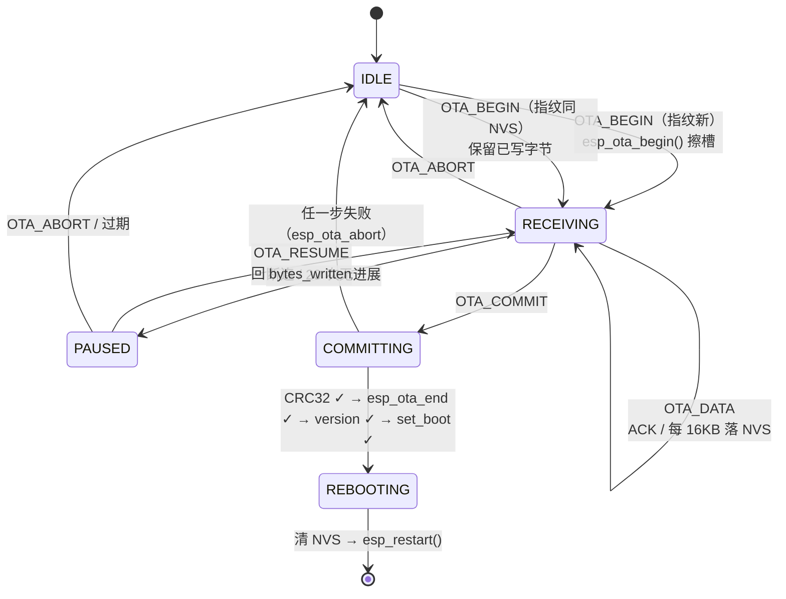

# OTA 线格式与续传会话（规格章节）

> 来源：[OTA 线格式与续传会话](https://github.com/sishoui/model-light/issues/8)。上游决策：[固件升级路径](https://github.com/sishoui/model-light/issues/7)（v1 做最小版 BLE OTA、双 1.5 MiB 槽、开回滚关 anti-rollback）、[BLE 协议与连接状态机](https://github.com/sishoui/model-light/issues/6)（`cmd(1)+seq(2)+payload`、窗口 8 片滑窗 ACK、整份 CRC32、令牌）。本票只定 OTA 的**形状**，不重开「做不做 OTA」。

---

## 0. 一句话

OTA 走**新建的独立特征**，复用 #6 的分片帧骨架与滑窗 ACK，载荷换成固件字节；设备侧在 NVS 记一份**可续传会话**，每 16 KB 落盘一次；**没有总超时**，只有 per-ACK 超时与无进展计数；提交顺序是 **整份 CRC32 → `esp_ota_end()` → `esp_ota_set_boot_partition()` → 重启**，任何一步失败都不改 boot partition。

---

## 1. GATT：OTA 用独立特征

| 特征 | UUID 后缀 | 属性 | 用途 |
|---|---|---|---|
| 命令 | `...0001` | WRITE_NR / NOTIFY | 不变（令牌、握手、状态请求） |
| 实时参数 | `...0002` | WRITE_NR | 不变 |
| 编排序列块 | `...0003` | WRITE_NR | 不变，**OTA 期间拒绝任何写** |
| 状态 | `...0004` | NOTIFY | 不变，`mode=2` + 进度字段 |
| 设备信息 | `...0005` | READ / NOTIFY | 不变 |
| **OTA** | **`...0006`** | **WRITE_NR + WRITE / NOTIFY** | **新增**：固件分片上行，ACK/事件下行 |

**为什么不全复用 `...0003`**：「写编排」与「写固件」共用一条写路径，意味着 OTA 进行中的「拒收编排」逻辑要散布在两处；单开一条特征让「OTA 中只接受 OTA 写」变成一条特征上的粗粒度闸门，漏的可能性小。

`...0006` 必须**同时**声明 WRITE 与 WRITE_NR：iOS 小程序不显式 `writeType:'writeNoResponse'` 会退化成带响应写，掉到每连接事件一包。`chunkSize = getBLEMTU() − 3`（iOS 20 B、Android 244 B），与 #6 一致。

---

## 2. 帧格式

### 2.1 上行（小程序 → 设备，写 `...0006`）

```
+------+--------+---------------------------+
| cmd  | seq    | payload                   |
| 1 B  | 2 B LE | 0..chunkSize-3 B          |
+------+--------+---------------------------+
```

与 #6 完全同构：单片**不带 CRC**（BLE 链路层已带），整份 CRC32 在 `OTA_COMMIT` 时校验。串行写约束保持（一次只有一个 write 在飞）。

### 2.2 命令表

| cmd | 名称 | payload | 说明 |
|---|---|---|---|
| `0x20` | `OTA_BEGIN` | `image_size(4 LE) + sha256(32) + app_version(32 ASCII) + crc32(4 LE)` = 72 B | 开新会话或确认续传。**不**带 `payloadVersion/protoMajor/protoMinor`——那是编排 TLV 的事，镜像自带 `esp_app_desc_t` |
| `0x21` | `OTA_QUERY` | 空 | 查当前会话，设备回 `OTA_SESSION` |
| `0x22` | `OTA_DATA` | 固件字节（≤ chunkSize−3） | 顺序追加；`seq` 为**片序号**，从 0 起 |
| `0x23` | `OTA_COMMIT` | 空 | 声明最后一片已发完，触发收尾 |
| `0x24` | `OTA_ABORT` | `reason(1)` | 主动放弃会话（用户取消） |
| `0x25` | `OTA_RESUME` | 空 | 断连后请求从 `bytesWritten` 继续，设备回 `OTA_RESUME_OK` 或提示重新 `OTA_BEGIN` |

### 2.3 下行（设备 → 小程序，notify `...0006`）

| cmd | 名称 | payload | 说明 |
|---|---|---|---|
| `0x30` | `OTA_ACK` | `seq_ack(2) + nakMask(1)` | 滑窗 ACK，窗口 8 片，语义同 #6：`seq_ack` = 累计已正确**写进 flash** 的片 |
| `0x31` | `OTA_SESSION` | `state(1) + bytes_written(4) + total_len(4) + sha256_prefix(8)` | `state`：0 无会话 / 1 进行中 / 2 待续传 / 3 已完成待重启 |
| `0x32` | `OTA_EVENT` | `event(1) + arg(1)` | `event`：1 = 已重启前同步 / 2 = 最终结果（`arg` = 错误码，0 = OK） |
| `0x33` | `OTA_RESUME_OK` | `bytes_written(4)` | 续传点已确认 |

> **ACK 只代表「已写进 flash」**，不代表「链路层收到了」。NIimBLE 的 ACL 缓冲在 host 被拖住时会静默丢包，所以 ACK 必须在 `esp_ota_write()` 返回成功之后才发。

---

## 3. 续传会话

### 3.1 设备侧记录

NVS 键 `ota_sess`（blob，固定 32 B）：

```c
typedef struct {
    uint8_t  sha256_prefix[16];  // 固件 SHA-256 前 16 字节
    uint32_t total_len;
    uint32_t bytes_written;      // 已成功写入 flash 的字节数（4 KB 对齐后才落盘）
    uint32_t crc32;              // OTA_BEGIN 带来的整份 CRC32
    uint8_t  state;              // 0 无 / 1 进行中 / 2 待续传 / 3 已完成待重启
    uint8_t  reserved[3];
} ota_session_t;
```

### 3.2 落盘节奏

**每 16 KB 落一次 NVS**（≈ block erase 粒度）。按 700 KB 固件算最多约 44 次写键，NVS 扇区磨损可忽略。

- **掉电最多重传 16 KB**（最坏情况：刚写完 16 KB 还没来得及落盘）。
- `bytes_written` 只记**4 KB 对齐**的值：NVS 的这次记录与被写的固件字节之间不可能原子，对齐后重传总落在块边界上，重写同一块是幂等的。
- 不追求「每片落盘」——每片 20 B 落一次会让 NVS 在 700 KB 内写 3.5 万次，flash 直接写穿。

### 3.3 对上会话（小程序重启 / 重进）

1. 小程序连上 → 读设备信息（固件版本）→ 发 `OTA_BEGIN`（同一镜像时设备**不清会话**，回 `OTA_SESSION`）。
2. 小程序发 `OTA_QUERY`，**以设备返回的 `bytes_written` 为准**。
3. `wx.setStorage` 里的 `{device_id, sha256_prefix, bytes_written}` 只用于给 UI 显示「上次到哪」，**永远不作为续传依据**。
4. 发 `OTA_RESUME`，设备回 `OTA_RESUME_OK(bytes_written)`；小程序从该字节偏移对应的片序号继续发。

### 3.4 换了固件怎么办

`OTA_BEGIN` 的 `sha256_prefix` 与 NVS 不符 → **静默作废旧会话**（`esp_ota_abort()` + 清 NVS 键 + 回 `OTA_SESSION{state=0}`），从头开始。不弹窗、不报错——用户看到的就是「从头开始」，这是正确语义。

---

## 4. 超时与重试

| 参数 | 值 | 说明 |
|---|---|---|
| per-ACK 超时 | **3 s** | 上一个窗口的 `OTA_ACK` 没回来就重发该窗口 |
| 无进展计数上限 | **20** | 连续 20 个窗口无新 ACK → 设备回 `OTA_EVENT{最终结果, 0x0C 等待续传}`，进入「待续传」 |
| 会话总超时 | **无** | #6 的 30 s 总超时**不适用** |
| 失败即丢弃 | **不适用** | 已写字节全部保留 |
| 重连退避 | 1 → 2 → 4 → 8 s，封顶 8 s | 小程序侧 |
| 会话过期 | 无时间上限 | 只在镜像指纹不符 / 用户 `OTA_ABORT` / 提交成功后清除 |

> 「20 次无进展」不是「失败」：`state` 置 2（待续传），灯效回到回放模式，用户下次进来点「继续」即可。这与 #7 的「续传不可砍」一致。

---

## 5. 提交

### 5.1 顺序（`OTA_COMMIT` 之后，不可插队）

```
收齐最后一片
  → 校验 bytes_written == total_len                    否 → 0x0A
  → 整份 CRC32 比对                                    否 → 0x0A
  → esp_ota_end()                                      否 → 0x09
  → 校验 esp_app_desc_t.version 对比 NVS min_allowed_version   否 → 0x0B
  → esp_ota_set_boot_partition()                       否 → 0x08
  → notify OTA_EVENT{最终结果, 0}
  → 等 500 ms（让 notify 发出去）
  → 清 NVS 会话 → esp_restart()
```

- 除了 `esp_ota_end()` 成功之后的 `set_boot_partition()`，**任何一步失败都调 `esp_ota_abort()` 并回错误码，绝不改 boot partition**。
- CRC32 在 `esp_ota_write()` 过程中**同步累加**，不额外遍历。

### 5.2 错误码扩展（接在 #6 的 0x00–0x07 之后）

| 码 | 名称 | 触发 | 小程序应对 |
|---|---|---|---|
| `0x08` | `OTA_FLASH_ERR` | `esp_ota_write` / `set_boot_partition` 返回非 `ESP_OK` | 提示「设备存储异常」，允许重试一次 |
| `0x09` | `OTA_IMAGE_INVALID` | `esp_ota_write` 首包 magic 不对，或 `esp_ota_end` 校验失败 | 提示「固件包损坏，请重新下载」 |
| `0x0A` | `OTA_CRC_MISMATCH` | 整份 CRC32 不符 / `bytes_written != total_len` | 自动重传（会话已作废，从头开始） |
| `0x0B` | `OTA_VERSION_REJECTED` | 镜像 `version` < NVS `min_allowed_version` | 提示「此版本过低」 |
| `0x0C` | `OTA_RESUME_WAITING` | 20 次无进展，进入待续传 | 显示「已暂停，可继续」 |

> `0x09` 里「首包 magic 不对」是**早期发现**：`esp_ota_write` 第一次调用就会因 magic 不对返回 `ESP_ERR_OTA_VALIDATE_FAILED`，所以在传了 4 KB 时就能拒掉，不用等整份传完。

---

## 6. 鉴权与并发

| 情形 | 行为 |
|---|---|
| 无令牌连接发 `OTA_BEGIN` | 回 #6 的 `0x02 NOT_TOKEN_HOLDER` |
| 持令牌方发 `OTA_BEGIN` | 进入 OTA，状态帧 `mode=2` |
| OTA 进行中，其他连接 | **降为只读**并收到 `mode=2`；不主动断开（断开是惊吓，只读等待可解释） |
| OTA 进行中，持令牌方断连 | `esp_ota_abort()`，`state=2`（待续传），灯效回放。**已写字节保留** |
| OTA 进行中，令牌被交接 | **禁止**：OTA 期间拒绝令牌交接，回 `0x05 BUSY` |
| 重启之后 | 令牌必然为空（设计内）。小程序靠状态帧的**固件版本号变化**判断「刷完了」，不靠令牌 |
| `OTA_BEGIN` 时设备未开回滚自检 | 若当前 app 处于 `PENDING_VERIFY`，先 `esp_ota_mark_app_valid_cancel_rollback()` 再开始（#7 §3.1 的坑） |

---

## 7. 升级期间的表现

### 7.1 状态帧扩展

#6 的 12 B 状态帧里 `mode=2`（传输中）保留，新增 **1 B 进度**字段（`bytes_written * 100 / total_len`，0–100），插在 `flags` 之后。变化的发送节奏不变（变化即发 + 5 s 心跳）**，但 OTA 期间进度百分比每变 1% 才发一次**，避免刷屏。

### 7.2 灯效

| 阶段 | 灯效 | 帧时钟 |
|---|---|---|
| `OTA_BEGIN` 成功 | 低亮度呼吸蓝（#1A3FCC，峰值 15%），**5 FPS** | 40 FPS 帧任务**暂停**，只留 5 FPS 心跳 |
| `OTA_DATA` 写入中 | 同上 | 同上 |
| 待续传（20 次无进展 / 断连） | 回到**正常回放**（`mode=2` 清除） | 恢复 40 FPS |
| 提交 → 重启 | 切到常亮绿（100%，1 帧后停刷） | 停帧 |

- 开 `CONFIG_RMT_ISR_IRAM_SAFE=y` 作为兜底（#7 §6.3）。
- **实时参数包在 OTA 期间拒收**，回 `0x05 BUSY`，**不静默丢**——静默丢会让小程序以为正在调参。

### 7.3 编排写

`...0003` 在 OTA 期间任何写都回 `0x05 BUSY`。

---

## 8. 会话状态机



| 状态 | NVS `state` | 灯效 | 可接受命令 |
|---|---|---|---|
| `IDLE` | 0 | 回放 | `OTA_BEGIN`, `OTA_QUERY` |
| `RECEIVING` | 1 | 呼吸蓝 5 FPS | `OTA_DATA`, `OTA_COMMIT`, `OTA_ABORT`, `OTA_QUERY` |
| `PAUSED` | 2 | 回放 | `OTA_RESUME`, `OTA_BEGIN`, `OTA_ABORT`, `OTA_QUERY` |
| `COMMITTING` | 3 | 呼吸蓝 | 无（只发事件） |
| `REBOOTING` | 0（已清） | 常亮绿 | 无 |

---

## 9. 小程序侧交互骨架

- **入口**：设备详情页「固件版本」行 → 点击进升级页。不放在首页，不做自动检查更新弹窗。
- **进度条最小信息**：百分比 + `已传 / 总大小`（如 `412 KB / 700 KB`）+ 一行「请保持亮屏，切换小程序会暂停升级」。
- **切后台 / 来电后的恢复文案**：「升级已暂停，回到本页可继续」+ 「继续」按钮。**不自动续传**——用户不知情地继续耗流量是更差的体验。
- **iOS / Android 耗时**：不预告知具体数字，只说「iOS 约 3–9 分钟，Android 约 1–2 分钟，请勿锁屏」。区间给宽是因为实测区间本身就这么宽（#7 分片 A）。
- **失败文案**按错误码映射到人话：`0x0A` → 「传输中断，将从断点继续」；`0x09` → 「固件包损坏，请重新下载」；其余见 §5.2。

---

## 10. 落地清单（给实现）

1. 新特征 `...0006`，WRITE + WRITE_NR + NOTIFY；`chunkSize = MTU − 3`。
2. `ota_writer` 任务（优先级低于帧时钟、高于空闲）消费 ringbuffer 并调 `esp_ota_write`，**不在 NimBLE 回调里写 flash**（#7 §6.2）。
3. 整份 CRC32 在写入路径同步累加。
4. NVS 会话键 `ota_sess`，每 16 KB 且 4 KB 对齐落盘。
5. ACK 只在 `esp_ota_write` 成功后发。
6. 所有失败路径都 `esp_ota_abort()`。
7. 状态帧加 1 B 进度；OTA 期间进度按 1% 节流。
8. 实时包与编排写在 OTA 期间回 `0x05 BUSY`（复用 #6 的 BUSY 码）。
9. 错误码表在 #6 的 8 个后追加 `0x08–0x0C`。
10. 令牌交接在 OTA 期间拒绝（`0x05 BUSY`）。
